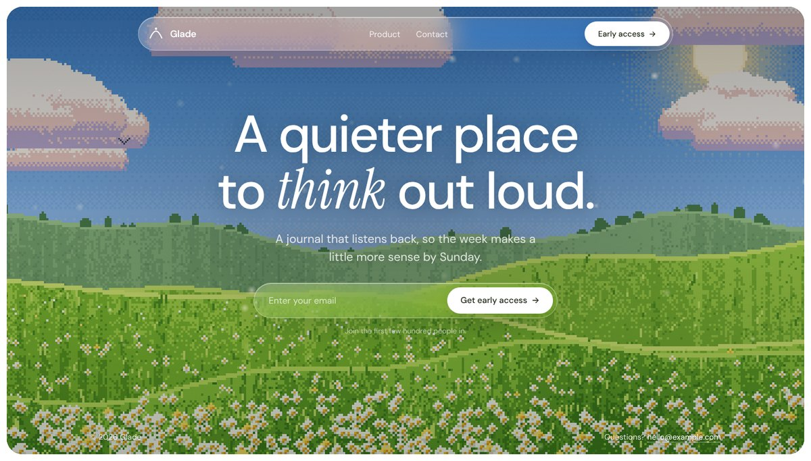
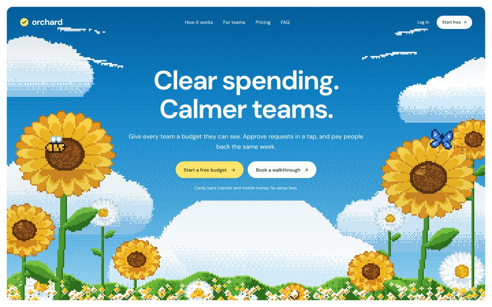
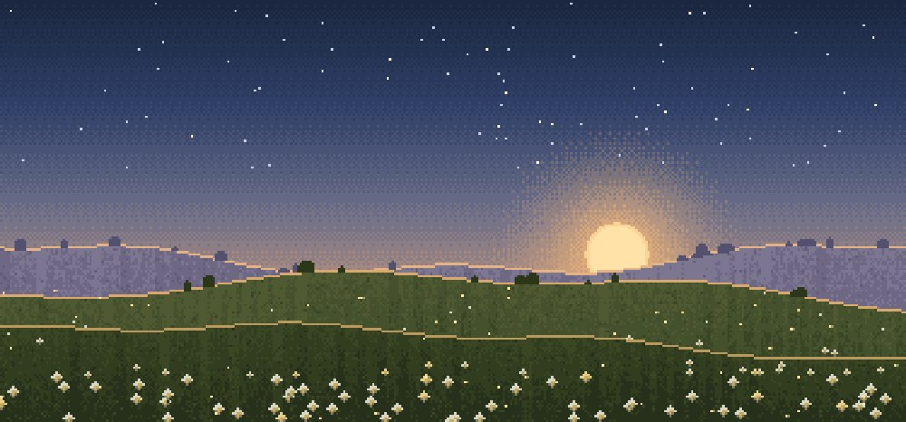
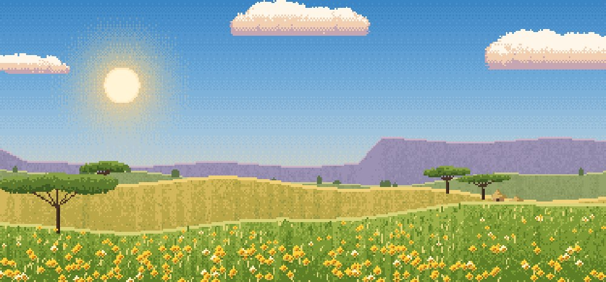
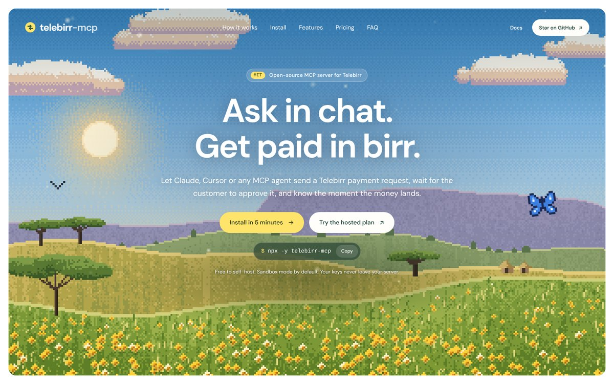

# pixel-meadow-ui

A Claude design skill for warm, premium landing pages: 16-bit pixel-art nature scenes inside rounded inset frames, frosted-glass pill navigation, DM Sans display type with one Instrument Serif italic accent, butter-yellow and white pill buttons, paper-white sections in deep green ink, pastel cards, and slow blur-in motion.

The pixel art is drawn in code by `pixel-scene.js` (zero dependencies), so pages ship without any image files.




## What it does

- **Two working templates**: a one-screen "cinematic" waitlist and a full "paper" product landing page (hero, proof strip, pastel step cards, tabs with a product mock, an art-card feature, pricing calculator, FAQ, closing band, footer)
- **Procedural pixel-art scenes** with four presets, plus pixel bees and butterflies, drifting pollen motes and mouse parallax
- **Design tokens and a component catalog**: exact type scale, colors, radii, spacing and motion curves, distilled from pages people love
- **Voice rules**: two-short-sentence headlines, kind microcopy, no hype words
- **Originality guardrail**: it reproduces a design language, never another site's name, logo, copy or artwork

## Scenes

| `meadow` | `bloom` |
|---|---|
|  |  |
| calm green hills, daisies, pastel clouds | giant sunflowers framing a bright sky |

| `dusk` | `highland` |
|---|---|
|  |  |
| setting sun, stars, fireflies (letters, about pages) | golden hour, table mountains, acacias, round huts |

Every scene takes a `seed` and custom `sky` color stops, and keeps the center clear for headline copy.

```js
PixelScene.mount(el, { preset: "highland", seed: 11, sky: ["#2a1f4f", "#5b3f7a", "#c06c84", "#f6b26b"] });
PixelScene.sprite(el, "bee", { scale: 5 });
PixelScene.pollen(canvas);
PixelScene.parallax(root);
```

## Example

From the prompt *"Build me a landing page for telebirr-mcp, an open-source MCP server that lets AI agents request and receive Telebirr payments"*:



## Install

**Claude Code (plugin, recommended)**

```
/plugin marketplace add lijnati/pixel-meadow-ui
/plugin install pixel-meadow-ui@pixel-meadow-ui
```

It is also listed in the [lijnati-skills](https://github.com/lijnati/saas-brand-namer) marketplace:

```
/plugin install pixel-meadow-ui@lijnati-skills
```

**Claude Code (manual)**

```bash
git clone https://github.com/lijnati/pixel-meadow-ui.git /tmp/pixel-meadow-ui
cp -r /tmp/pixel-meadow-ui/skills/pixel-meadow-ui ~/.claude/skills/
```

**Claude apps**

Build the package with `./build.sh`, then upload `dist/pixel-meadow-ui.skill` in Claude's skills settings.

## Usage

Ask for a page in plain words. The skill triggers on requests like:

- "build a landing page for my MCP server, cozy pixel-art style"
- "coming soon page for my wellbeing app, calm, like you can breathe looking at it"
- "write our founder letter as a long-read page with a dusk scene"
- "restyle my pricing section to feel warm and indie"

It works with plain HTML, React/Next.js and Tailwind.

## Repo layout

```
.claude-plugin/
  plugin.json               plugin manifest
  marketplace.json          lets this repo act as its own marketplace
skills/pixel-meadow-ui/
  SKILL.md                  workflow, non-negotiables, voice
  references/tokens.md      type, color, shape, motion specs
  references/components.md  section patterns and scene API
  assets/pixel-scene.js     procedural pixel-art generator
  assets/template-*.html    working templates
docs/                       preview images
```

## Development

```bash
claude plugin validate .    # validate plugin and marketplace manifests
./build.sh                  # package dist/pixel-meadow-ui.skill
```

To preview the templates, serve `skills/pixel-meadow-ui/assets/` with any static server and open `template-product.html` or `template-cinematic.html`.

## License

MIT
